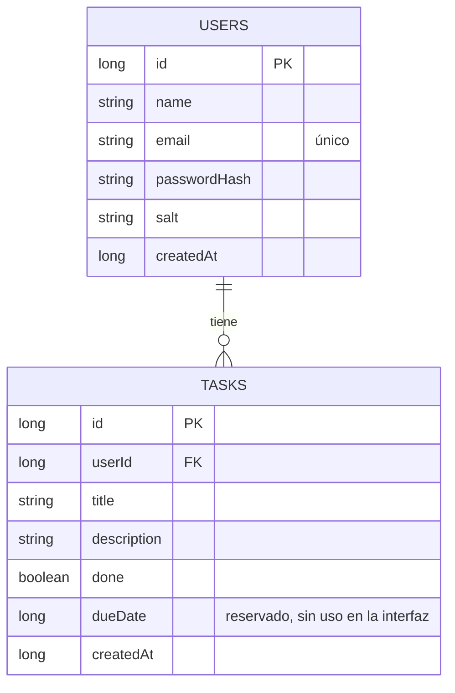

# Tareas: App Android con Login/Registro y CRUD

Aplicación Android nativa (Kotlin) para gestionar tareas personales. Cada usuario se registra, inicia sesión y administra **solo sus propias tareas** (crear, listar, ver detalle, editar y eliminar). Todos los datos se guardan localmente en el dispositivo.

Proyecto final de la asignatura de Desarrollo Web y Móvil.

- **Autor:** `<Tu nombre completo>`
- **Asignatura / institución:** `<Nombre de la asignatura> – <Institución>`

---

## Cómo ejecutarlo en 3 pasos

**1. Clonar el repositorio**

```bash
git clone <URL-DEL-REPOSITORIO>
```

**2. Abrirlo en Android Studio y sincronizar**

- Abre Android Studio y elige **File → Open**, seleccionando la carpeta clonada.
- Espera a que termine **Sync Project with Gradle Files**. Si falta alguna pieza del SDK, Android Studio ofrece descargarla desde el mismo aviso (acepta).

**3. Ejecutar**

- Selecciona un emulador (o un teléfono con depuración USB) con **Android 7.0 (API 24) o superior**.
- Pulsa el botón verde **Run ▶**.

No hay usuarios precargados: al abrir la app, toca **Crear cuenta** para registrarte.

---

## Requisitos

| Elemento | Versión |
|---|---|
| Android Studio | Rabbit 1 \| 2026.2.1 (o superior) |
| Android Gradle Plugin | 9.4.1 |
| compileSdk / targetSdk | 37 |
| minSdk | 24 (Android 7.0) |
| Lenguaje | Kotlin |
| Compatibilidad Java | 11 |

No hace falta instalar Gradle: el proyecto incluye el *Gradle Wrapper*. El archivo `local.properties` (ruta del SDK) lo genera Android Studio automáticamente y no se incluye en el repositorio.

---

## Funcionalidades

**Autenticación**
- Registro con nombre, correo y contraseña (con confirmación).
- Inicio de sesión local y **sesión persistente**: si ya iniciaste sesión, la app abre directamente la lista.
- Cierre de sesión desde el menú de la lista.

**CRUD de tareas**
- **Crear** y **editar** desde un único formulario con validación.
- **Listar** en un `RecyclerView` que se actualiza solo al crear, editar o eliminar.
- **Detalle** de cada tarea con acciones: marcar como hecha/pendiente, editar, compartir y eliminar.
- **Eliminar** con diálogo de confirmación (desde la lista o el detalle) y opción **Deshacer** desde la lista.

**Experiencia de usuario**
- Estado vacío cuando no hay tareas.
- Mensajes de éxito y error con Snackbar y errores por campo en los formularios.
- Validación en tiempo real: una vez que un campo muestra un error, se revalida al escribir.
- Accesibilidad básica: textos de 14 sp o más, botones de al menos 48 dp, etiquetas en los campos y descripciones de contenido en los íconos.
- Estilo visual de "papel/nota adhesiva" con colores de alto contraste.

---

## Validaciones

| Campo | Regla |
|---|---|
| Correo | No vacío y con formato válido. Único por usuario |
| Contraseña | Mínimo 6 caracteres |
| Confirmar contraseña | Debe coincidir con la contraseña |
| Nombre | No vacío |
| Título de tarea | Obligatorio, máximo 60 caracteres |
| Descripción de tarea | Opcional, máximo 300 caracteres |

---

## Arquitectura

Patrón **MVVM** con capa de repositorio:

```
Fragment (View)  →  ViewModel  →  Repository  →  DAO  →  Room (SQLite)
  dibuja y            estado y        reglas de       SQL      tablas
  reenvía eventos     lógica de       acceso a        tipado
                      pantalla        datos
```

- **View:** Fragments con ViewBinding y Navigation Component (una sola Activity).
- **ViewModel:** valida, coordina y expone el estado con `LiveData`.
- **Repository:** única puerta de acceso a los datos; los fallos se devuelven como `DbResult` o `AuthResult` en lugar de lanzar excepciones.
- **Room:** persistencia local; las listas se observan con `Flow`, por lo que la interfaz se refresca sola.

### Estructura de paquetes

```
com.example.proyecto_desarrollo
├── MainActivity
├── data
│   ├── local        → AppDatabase, UserDao, TaskDao
│   ├── model        → User, Task
│   └── repository   → AuthResult, DbResult, SessionManager, UserRepository, TaskRepository
├── ui
│   ├── auth         → AuthState, AuthViewModel, LoginFragment, RegisterFragment
│   ├── list         → TaskAdapter, TaskListViewModel, TaskListFragment
│   ├── form         → TaskFormViewModel, TaskFormFragment
│   └── detail       → TaskDetailViewModel, TaskDetailFragment
└── util             → HashUtil, Validators
```

---

## Esquema de datos



- Si se elimina un usuario, sus tareas se eliminan en cascada.
- El esquema exportado por Room está en [`app/schemas/`](app/schemas/).

---

## Seguridad

- La contraseña **nunca se guarda en texto plano**: se almacena su hash SHA-256 combinado con un *salt* aleatorio por usuario. Es una medida de carácter educativo; en producción se usarían algoritmos diseñados para contraseñas, como bcrypt o Argon2.
- La sesión solo guarda el **id** del usuario en `SharedPreferences` privado, nunca la contraseña.
- Cada consulta de tareas se filtra por el usuario con sesión activa, por lo que nadie ve datos de otro.

---

## Tecnologías y librerías

| Librería | Versión |
|---|---|
| Room (+ KSP 2.3.11) | 2.8.5 |
| Navigation Component | 2.10.2 |
| Lifecycle (ViewModel, LiveData) | 2.11.0 |
| Fragment KTX | 1.9.1 |
| Material Components | 1.14.0 |
| RecyclerView | 1.4.0 |

---

## Solución de problemas

- **El sync de Gradle falla por una plataforma faltante:** abre **Tools → SDK Manager** e instala *Android SDK Platform 37*.
- **Rojo en `ItemTaskBinding`, `FragmentLoginBinding`, etc. aunque compila:** son clases generadas por ViewBinding. Ejecuta **Build → Make Project** y, si persiste, **File → Invalidate Caches → Invalidate and Restart**.
- **Quiero empezar de cero:** desinstala la app del emulador o usa **Settings → Apps → Tareas → Storage → Clear data**.
